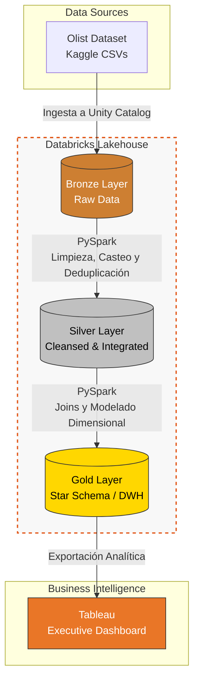

# 🛒 E-Commerce Lakehouse & Customer Intelligence

Una plataforma analítica de e-commerce moderna construida sobre **Databricks** y **PySpark**, implementando una arquitectura **Medallion Lakehouse (Bronce, Plata, Oro)** y un Data Warehouse dimensional para Business Intelligence.

Este proyecto procesa más de 100,000 registros transaccionales (basado en el dataset público de Olist), aplicando ingeniería de datos rigurosa para transformar datos crudos en métricas de negocio accionables.

---

## 🏗️ Arquitectura de Datos (Medallion)

El pipeline de datos está orquestado en 3 capas progresivas utilizando **Delta Lake**:

1. **🥉 Capa Bronce (Raw):** Ingesta inmutable de datos transaccionales crudos (Orders, Items, Products, Customers) preservando el esquema original.
2. **🥈 Capa Plata (Cleansed & Integrated):** Limpieza de datos, *type casting*, manejo de valores nulos, deduplicación e integración de entidades mediante uniones optimizadas en Spark.
3. **🥇 Capa Oro (Data Warehouse):** Modelado dimensional (*Star Schema*) optimizado para consultas analíticas. Generación de llaves subrogadas y métricas de negocio pre-calculadas.

## 📊 Calidad de Datos (Data Quality)

Se implementaron controles automatizados con PySpark antes de exponer la información a la capa analítica, logrando:
* **Registros procesados:** 112,650
* **Integridad referencial (Llaves nulas):** 0
* **Consistencia de negocio (Precios inválidos):** 0
* ✅ **Tasa de registros válidos:** 100.00%

---

## 📈 Análisis y Business Intelligence (Frontend Analítico)

> **[En desarrollo]** Esta capa consumirá el modelo dimensional (Capa Oro) para responder preguntas críticas del negocio.

* **Herramienta:** Tableau
* **KPIs Core:** Ingresos totales, ticket promedio, volumen de ventas por categoría.
* **Dashboard Interactivo:** *(El enlace a Tableau Public se añadirá pronto)*
* **Vista previa:** *(Imagen del dashboard se añadirá pronto)*

---

## 💻 Tecnologías Utilizadas
* **Procesamiento Distribuido:** Apache Spark, PySpark
* **Infraestructura & Almacenamiento:** Databricks, Delta Lake, Unity Catalog
* **Lenguajes:** Python, SQL
* **Modelado:** Dimensional Modeling (Star Schema)