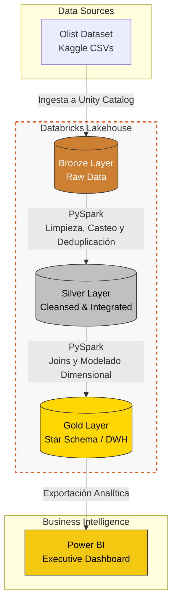
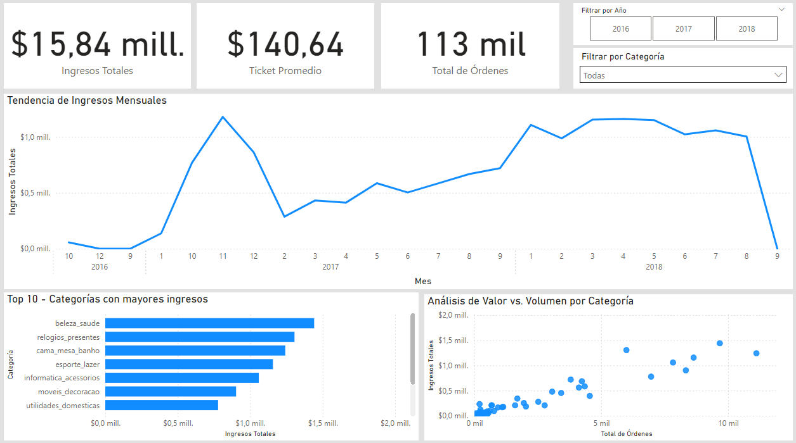

# 🛒 E-Commerce Lakehouse & Customer Intelligence

Una plataforma analítica de e-commerce moderna construida sobre **Databricks** y **PySpark**, implementando una arquitectura **Medallion Lakehouse (Bronce, Plata, Oro)** y un Data Warehouse dimensional para Business Intelligence.

Este proyecto procesa más de 100,000 registros transaccionales aplicando ingeniería de datos rigurosa para transformar datos crudos en métricas de negocio accionables.

---

## 📂 Fuentes de Datos (Dataset)
* **Origen:** [Brazilian E-Commerce Public Dataset by Olist (Kaggle)](https://www.kaggle.com/datasets/olistbr/brazilian-ecommerce)
* **Alcance del Proyecto:** Para enfocar el pipeline en la analítica transaccional y de clientes, se extrajeron y procesaron únicamente las siguientes 4 entidades *core* del modelo relacional original:
  * `olist_orders_dataset.csv`
  * `olist_order_items_dataset.csv`
  * `olist_products_dataset.csv`
  * `olist_customers_dataset.csv`

---

## 🏗️ Arquitectura de Datos (Medallion)

El pipeline de datos está orquestado en 3 capas progresivas utilizando **Delta Lake**:

1. **🥉 Capa Bronce (Raw):** Ingesta inmutable de datos transaccionales crudos preservando el esquema original.
2. **🥈 Capa Plata (Cleansed & Integrated):** Limpieza de datos, *type casting*, manejo de valores nulos, deduplicación e integración de entidades mediante uniones optimizadas en Spark.
3. **🥇 Capa Oro (Data Warehouse):** Modelado dimensional (*Star Schema*) optimizado para consultas analíticas. Generación de llaves subrogadas y métricas de negocio pre-calculadas.

---

## 📊 Calidad de Datos (Data Quality)

Se implementaron controles automatizados con PySpark antes de exponer la información a la capa analítica, logrando:
* **Registros procesados:** 112,650
* **Integridad referencial (Llaves nulas):** 0
* **Consistencia de negocio (Precios inválidos):** 0
* ✅ **Tasa de registros válidos:** 100.00%

*(Se pueden revisar las capturas de ejecución exitosa del clúster en la carpeta `/docs` de este repositorio).*

---

## 📈 Análisis y Business Intelligence (Frontend Analítico)

Para cerrar el ciclo de vida del dato y generar valor de negocio, la capa Oro (Data Warehouse) fue conectada a **Power BI** para el desarrollo de un Dashboard Ejecutivo.

El modelo de datos permite a los *stakeholders* responder preguntas estratégicas en segundos:
* **Monitoreo de KPIs:** Seguimiento de Ingresos Totales ($15.84M), Volumen de Órdenes (113K) y Ticket Promedio ($140.64).
* **Tendencia Histórica:** Análisis de la estacionalidad de las ventas a través de un *drill-down* interactivo por año y mes.
* **Rendimiento de Productos:** Identificación automática del Top 10 de categorías más rentables.
* **Matriz Estratégica:** Gráfico de dispersión (Volumen vs. Valor) para detectar qué categorías requieren mayor empuje de marketing.

> **Vista del Dashboard Ejecutivo:**
> 

---

## 🚀 Guía de Replicación (How to Run)

Para evaluadores técnicos que deseen replicar el pipeline de datos en su propio entorno:

1. Desplegar un clúster en **Databricks Community Edition** (o entorno productivo).
2. Descargar los 4 archivos CSV mencionados en la sección de *Fuentes de Datos* desde Kaggle.
3. Cargar los archivos crudos en un volumen de Unity Catalog (ej. `workspace.default.olist_raw_data`).
4. Clonar este repositorio e importar los notebooks de la carpeta `/src` al *Workspace* de Databricks.
5. Ejecutar los notebooks en orden secuencial (del `01` al `06`) para orquestar el flujo desde la ingesta hasta la capa analítica.

---

## 💻 Tecnologías Utilizadas
* **Procesamiento Distribuido:** Apache Spark, PySpark
* **Infraestructura & Almacenamiento:** Databricks, Delta Lake, Unity Catalog
* **Visualización & BI:** Power BI
* **Lenguajes:** Python, SQL
* **Modelado:** Dimensional Modeling (Star Schema)